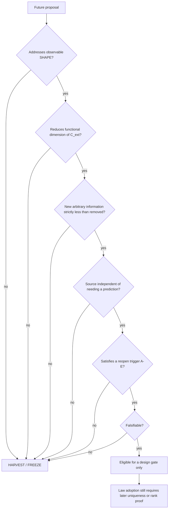

# PTQ Predictivity Boundary and Reopen Contract:
# Constitutive Freedom, Identifiability, and Scientific Stop Conditions

**Document type:** internal authoritative whitepaper  
**Mode:** harvest documentation only  
**Audience:** future PTQ researchers, AI research agents, maintainers, internal reviewers  
**Not:** a journal submission, a maturity upgrade, or a license to reopen deep science  

**Status freeze (do not rewrite):**

```text
PRED-01 = D
PRED-02 = C
PRED-03 = B
ONTO-00 = B
CONST-00 = E
CONST-01A = C
CONST-X01 = D / X0_NONE
NP-00 = D / HYPOTHESIS_ONLY
EMP-00 = C / EP-2
EMP-01A = D / ER-D
G5 = NOT_NEAR_TERM_VIABLE
DEEP_SCIENCE = CLOSED
H1 = H1-C2 / QUARANTINED
E2 = FROZEN_AS_HARVEST_ASSET
H_ref = UNOPENED
C_PTQ = UNDEFINED
PDE_LADDER = STOPPED
NO_RP6
```

This whitepaper is a **boundary map**, not a victory claim.

---

## 1. Executive Summary

PTQ, in the frozen theory, determines a geometric law *schema* and a
local mixed initial–boundary problem for the metric at a **fixed**
constitutive package. It does **not** determine two remaining
constitutive maps of one scalar. The authorized operational family is
an indexed proper-time / clock response. That family’s linearized
constitutive map has a nontrivial **functional** kernel. Analytic
admissibility does not select the package. Additional sectors
(homogeneous cosmology, matter sources, tensor characteristics, global
numbers) do not supply a second independent constitutive equation.
Hand-written generators and invented observables do not compress
information. The empirical “measure, freeze, predict” route is not
near-term viable. Deep predictivity work is **closed** until a
documented reopen trigger is proved.

What the framework **does** determine: the law form; the
state/environment/gauge split; the local two-function remainder after
proved equivalences; an explicit kernel for the named clocks; and a
list of repairs that fail for structural reasons.

What remains **free**: \((f_1(\phi),Z_{\mathrm{geom}}(\phi))\) modulo
the proved reparameterization/IBP/rescaling equivalence, as maps, not
as two numbers.

---

## 2. Scope and Non-Claims

**In scope:** constitutive remainder, functional information, filter
versus selector, cross-sector rank, generator audit, identifiability,
measurement-interface audit, stop conditions, reopen contract.

**Out of scope / non-claims:**

- PTQ is not declared complete, and not declared observationally
  falsified.
- H1 remains quarantined; this document does not repair it.
- \(H_{\mathrm{ref}}\) and \(C_{\mathrm{PTQ}}\) remain unopened /
  undefined; no normalization is performed.
- No SPARC, cosmology, or laboratory fit is reported.
- No new theorem is proved here; statements are restatements of
  already-authorized results (G1BA, PRED-01/02/03, CONST-00/01A/X01,
  NP-00, EMP-00/01A).
- Coupled-branch ontology is not adopted.
- No general inverse-problem theorem stronger than the standard
  kernel criterion is claimed.

---

## 3. PTQ Predictivity Problem

A theory is predictively closed, in the sense used here, when

\[
\mathrm{LAW}+\text{authorized state/environment data}
\;\longmapsto\;
\text{authorized observables}
\]

leaves no **arbitrary functions** in the constitutive slot. Ordinary
multiplicity of solutions at a *fixed* constitutive package is
state, analogous to distinct Einstein solutions, and is not by itself
a constitutive failure.

PRED-01: the only authorized operational family is the indexed clock
response \(\{r_p,\Delta_J r_p\}\). Nontrivial unindexed observables
remain selection-dependent. PRED-03: at fixed authorized state data,
the clocks still depend on unresolved constitutive functions
(conditional predictivity fails at the functional level). The problem
is therefore **not** missing Cauchy data of the metric. It is the
two-function constitutive remainder.

---

## 4. Law / State / Constitutive Separation

PRED-03 classification (not rewritten):

| object | category |
|---|---|
| action *form* \(A=SG+\mathrm{Hess}\,S+Q\) | LAW (schema) |
| \(\bar g|_D\) at fixed \((S,Q)\) | STATE (solution) |
| \(d_{\mathrm{state}}\), \(F_{\mathrm{free}}\), traces, \(J_{\mathrm{phys}}\) | STATE / source |
| probe \(p\), preparation \(\beta\) | ENVIRONMENT |
| \(S\), \(Q=q(S)\,dS\otimes dS\), \(q(S)\), \((f_1,Z)\) | CONSTITUTIVE_EXTERNAL |
| projective spurion / diffeomorphism representatives | GAUGE (already quotiented) |
| \(H_{\mathrm{ref}}\), \(C_{\mathrm{PTQ}}\) | REFERENCE, unopened / undefined |

\(S\) and \(Q\) are **not varied** and have **no independent evolution**
(A568). They are not Cauchy data. \(\phi_{\mathrm{bg}}\) is a
prescribed background evaluation coordinate, not a dynamical scalar
of the frozen theory.

\[
S_{\min}
\;=\;
\bigl[\bar g|_D\bigr]_{\text{STATE-like}}
\;\times\;
\bigl[S,Q,q\bigr]_{\text{CONSTITUTIVE}}
\Big/\sim_{\mathrm{pred}}.
\]

The predictive quotient removes gauge and proved equivalences. It does
not remove the two-function remainder.

---

## 5. Canonical Constitutive Remainder

CONST-00. After \(\phi\)-reparameterization with transported
background, bulk-null IBP, and joint rescaling with \(\kappa\):

\[
C_{\mathrm{ext}}
=
\mathfrak M_{\mathrm{const}}
=
\bigl[(f_1,Z_{\mathrm{geom}})\bigr]_{\sim_{\mathrm{R1}}}.
\]

This is a **local two-function** moduli problem (maps of one scalar),
not two numerical parameters. Conformal removal of \(f_1\) is **not**
an equivalence. On-shell elimination of an auxiliary potential drops
an independent vacuum-response modulus but does not identify \(Z\)
from \(f_1\). Realized \((S,Q)|_D\) is evaluation of the same maps on
\(\phi_{\mathrm{bg}}\), not extra spacetime free fields after
realization.

Degenerate loci \(f_1=0\), \(\Delta=0\) are retained and not promoted
to a dimension drop.

---

## 6. Functional Information Budget

CONST-01A:

```text
IB-2
```

Two genuine functional degrees remain.

| residual | meaning | predictive closure? |
|---|---|---|
| FDIM-2 | both maps free | no (present) |
| FDIM-1 | one free map | no |
| FDIM-FINITE | finitely many constants | effective fallback only |
| FDIM-0 | no arbitrary function | yes |

One regular pointwise algebraic scalar \(C(f_1,Z)=0\) yields FDIM-1.
\(Z=F(f_1)\) with free \(F\) **renames** IB-2. A single global number
does not cut a map. Extra displayed equations do not count unless they
shrink the kernel on the function space.

---

## 7. Why Admissibility Does Not Select the Package

PRED-02. Mathematical admissibility conditions on the mixed
boundary-value problem, even if all later proved in a neighborhood of
the control witness **at fixed package**, constrain analytic data
about that package. They do not identify a unique, finite, or
scale-only subclass of the constitutive family.

```text
FILTER, not SELECTOR
```

The control witness \(\eta\), \(S=-\log t\), \(q\equiv 1\) shows that
admissibility need not empty the known local solution sector. Forcing
a selector by declaring a new constitutive PDE is a different theory.

---

## 8. Why One Constitutive Relation Is Insufficient

CONST-01A PCLASS-A. On a regular locus, one independent algebraic
scalar constraint removes one map’s worth of freedom and leaves the
other arbitrary. Two independent, kernel-free algebraic scalars could
in principle give FDIM-0, but no such pair is derived, and choosing
them by hand is a hidden function. Relational fixed points
\(c=R[c]\) close only if \(R\) is uniquely determined and the fixed
point is unique; no such \(R\) is sourced. Cross-sector class is
logically contingent; CONST-X01 showed currently writable reductions
are not independent constraints.

---

## 9. Cross-Sector Functional-Rank Audit

CONST-X01. No authorized pair reduces IB-2 to FDIM-0.

| sector | constitutive constraint rank | note |
|---|---|---|
| weak-field clocks | FR-0 as \(E=0\); WF-FR1 as *sensitivity* | kernel nontrivial |
| homogeneous cosmology | COS-NOETHER / FR-0 | specialization, identity, or state ODEs |
| matter | MAT-X0 | source index; extra \(S_m\) |
| torsion/projective realization | TP-FR0 | realizes \(Z\), does not constrain the pair |
| tensor characteristics | GW-FILTER | \(\mathrm{Char}=\{k^2=0\}\) if \(S\neq 0\) |
| global/projective numbers | GL-FR0 | not functions of \(\phi\) |
| QFT / coupled-branch | not eligible | firewall |

A second background is not a second law. Noether identities of the
same tensor equation are not a second constitutive map. Gauge is not
constitutive information.

```text
X0_NONE
```

---

## 10. New-Physics Generator Audit

NP-00, hypothesis only, not theory.

| class | result |
|---|---|
| generating functional \(J_{\mathrm{const}}\) | no canonical source; hand-picked \(J\) is a hidden function (typically a Finsler target on the \((f_1,Z)\)-plane) |
| relational \(R\) | no unique kernel-free \(R\) |
| spectral \(D\) | no canonical operator on the pair; hand \(\lambda\) yields an infinite family |
| coupled branch | information expanding (free \(K\), measures, weights) |
| empirical UNI sector | viable *in principle* as measurement, still underidentified |

Do not add two arbitrary equations to remove two arbitrary functions.
A generator must contain **less** arbitrary information than the
freedom it removes. No generator was adopted. NP-01 is not authorized.

---

## 11. Empirical Identifiability Audit

EMP-00, design only. Unknown \(c=(f_1,Z_{\mathrm{geom}})\). Authorized

\[
M_0[c;D_{\mathrm{state}}]
=
\{r_p,\Delta_J r_p\}.
\]

Linear map \(DM_0:(\delta f_1,\delta Z)\mapsto\delta Y\).

Local class: **ID-LF** (functional nullspace). Global class: **ID-GF**
(observationally equivalent distinct maps). MEAS-3 preserved.
Sensitivity WF-FR1 is not identifiability.

G1BA kernel \(K_{\Delta R}\) (not gauge):

- constitutive variations off \(\mathrm{im}(\phi_{\mathrm{bg}})\);
- \(Z\)-direction on the constant-\(\phi\) GR-like sector;
- residual split of the two maps on generic nonconstant backgrounds
  **not proved empty**.

Finite sampling does not kill a functional kernel. A finite polynomial,
spline, or network basis is a numerical witness at most;
identification that vanishes as the basis dimension increases is a
truncation artifact. Conditioning of the present non-injective map:
undefined as an inverse. Universality of \(c\) across systems is a
hypothesis (UH-2). Logical A→freeze→B is well-defined but has **no
authorized A** independent of \(\{r_p\}\). SPARC may not be both
calibration and confirmation.

---

## 12. Measurement-Interface Audit

EMP-01A. Required type for an empirical closer: a second independently
motivated constitutive kernel **and** operational \(\phi\)-tomography
with independently known \(\phi\) and genuine \(Z\)-access.

Inventory: extra probes, two-clock ratios, preparations, matter
indices, and background re-evaluation are the **same** kernel as
\(M_0\) or add nuisance functions (matter: NET_NONPOSITIVE). The
characteristic cone cuts nothing in \((f_1,Z)\). Lensing / GW amplitude
/ rotation-curve maps are not constructed as PTQ operational families;
writing them to fill Jacobian rank is injectivity engineering.
\(\phi_{\mathrm{bg}}\) is not an independently known scan coordinate
and must not be dynamized.

MI-A realized: **NO**. MI-C operational: **NO**. Combined architecture:
**MIC-0**. G5: **NOT_NEAR_TERM_VIABLE**.

---

## 13. Final Predictivity Boundary

Present tense:

```text
C_ext = [(f1(phi), Z_geom(phi))]_{~R1}
IB = IB-2
SHAPE = SHAPE-F
MEAS-3 = PRESERVED
G5 = NOT_NEAR_TERM_VIABLE
DEEP_SCIENCE = CLOSED
```

The theory is package-conditional: given \(c\), indexed clocks are a
legitimate linearized response. The theory is **not** constitutively
predictive of those clocks as a unique shape, and not empirically
closed by a freeze-and-transport program with present interfaces.

---

## 14. Failed-Route Ledger

See also `FAILED_ROUTE_MAP.md` in the release package. Compact list:

Admissibility-as-selector; preferred-probe flagship number; one
algebraic relation; FLRW as second law; generic matter inversion;
GW cone as constitutive equation; global numbers as maps; kinetic
terms for prescribed scalars; hand-chosen \(J\), \(R\), or \(D\);
coupled-branch repair; same-catalog fit; extra clocks as a second
kernel; prescribed \(\phi\) as tomography; invented lensing/GW
dictionaries; finite-basis identification; scale-first normalization.

Each fails for a **scientific** reason recorded in the map, not by
fiat. Retries require a reopen trigger, not a new label.

---

## 15. Hidden-Function / SG-T Firewall

Information compression:

\[
(\text{old functional freedom})
-
(\text{new independent arbitrary freedom}).
\]

Replacing two maps by one free operator plus one free map has
compression \(\le 0\). A free potential, Finsler target metric,
relational kernel, spectrum, branch weight, or calibration map that
stands in for \((f_1,Z)\) is a **hidden function**.

Dynamizing \(S,Q\) (historical C4) transfers underdetermination into
initial/boundary data of new kinetics (SG-T). That transfer is not a
predictivity repair of the frozen theory. Do not repeat it under new
notation.

---

## 16. Shape-Before-Scale Firewall

SHAPE-F is functional constitutive remainder. INV-3: constitutive
variation changes clock **shape**, not merely a unit. Opening
\(H_{\mathrm{ref}}\) or defining \(C_{\mathrm{PTQ}}\) first would
confound identification with a scale choice. Normalization remains
**not started**. Shape out of sample would have to pass before scale
could be opened. That test is not currently executable.

---

## 17. Future Hypothesis Admission Contract

A hypothesis may enter even a *design* gate only if: labeled
hypothesis; no rewritten historical verdict; information content
declared; positive compression; independent motivation; no hidden
function; witness not emptied without physical reason; shape before
scale; falsifiable; empirical A and B not the same target.

Fail any item: **not admitted**. Admission is not adoption of a law.

---

## 18. Reopen Triggers

No trigger ⇒ harvest / freeze.

| ID | required |
|---|---|
| A | uniqueness theorem for a generator with no free potential/kernel |
| B | independent cross-sector \(E[f_1,Z]=0\) of positive constitutive rank |
| C | physically motivated interface, kernel \(\neq DM_0\), known \(\phi\)-interval, \(Z\)-access, nonpositive nuisance |
| D | real imported sector with proved constitutive rank |
| E | non-circular external evidence incompatible with the present family |

Non-triggers: selector postulates; C4; O3 as repair; \(H_{\mathrm{ref}}\);
normalization-as-closure; invented second clock; same-dataset splits;
rewriting verdicts.

---

## 19. Reopen Decision Tree



Design-gate eligibility is not a license to modify canonical equations,
vary \(S/Q\), open \(H_{\mathrm{ref}}\), or fit SPARC.

---

## 20. Long-Term Research Watch List

Watch **only** (no automatic task):

- An independently motivated uniqueness theorem for a 1D generating
  structure on \((f_1,Z)\) with no free target metric.
- A derived constitutive identity from a sector that is not a
  specialization or Noether consequence of the metric equation.
- A PTQ-derived operational map (e.g. null geodesics) whose
  constitutive kernel is **proved** independent of \(M_0\), constructed
  for physical reasons other than Jacobian rank.
- An independent operational readout of \(\phi\) that does not
  dynamize \(\phi_{\mathrm{bg}}\).
- A real, not analogical, bridge to another completed theory sector.

Do not watch SPARC refits, preferred-probe numbers, or ontological
drama as closure mechanisms.

---

## 21. Claim Boundary

**May be used internally as determined:**

- two-function remainder after R1;
- IB-2;
- filter ≠ selector;
- X0 on existing sectors;
- explicit \(K_{\Delta R}\) for \(M_0\);
- MEAS-3;
- G5 not near-term viable;
- listed failed routes.

**Must not be inflated to:**

- “no observable in nature can identify the maps”;
- “PTQ is false”;
- “PTQ is finished”;
- “all modified gravity is non-identifiable”;
- nonlinear global uniqueness failure beyond what was proved;
- observational exclusion;
- SPARC or cosmological closure in this document;
- unique physical branch.

---

## 22. Historical Traceability

| topic | authority |
|---|---|
| clock family only | PRED-01; G1AW/G1AY |
| kernel \(K_{\Delta R}\) | G1BA |
| identifiability MEAS-3 | G1BA; CONST-00; EMP-00 |
| law/state split | PRED-03 |
| filter/selector | PRED-02 |
| remainder / IB-2 | CONST-00; CONST-01A |
| cross-sector X0 | CONST-X01 |
| generators | NP-00 (hypothesis) |
| A/B design | EMP-00 |
| interface existence | EMP-01A |
| C4 / SG-T | RP5 |
| SPARC firewall | A40–A42 |
| H1 quarantine | H1-C2 |
| E2 | frozen harvest asset |
| this packaging | HARVEST-PRED-01/02 |

See `evidence/harvest_pred_02/claim_traceability.tsv`.

---

## 23. Conclusions

PTQ’s predictivity line has reached a **structural stop**, not a
clerical one. The metric law at fixed constitutive maps is a
conditional theory. The constitutive maps remain two functions. The
named clocks do not identify them. Common repairs do not add
information. The correct current status is harvest / freeze, with
explicit triggers. This whitepaper exists so that future sessions do
not reopen selector, C4, O3, \(H_{\mathrm{ref}}\), normalization,
SPARC fitting, or invented interfaces without new authority.

**Do not start deep science from this file.**

---

## Appendix A — Linearized sensitivity chain (authorized restatement)

G1BA. Background duration \(\bar\tau_p=\tau[\bar g_b,P_p]\) is
independent of \(c\). Therefore

\[
D_c(\Delta_J r_p)
=
\frac{1}{\bar\tau_p}\,
D_c\bigl(\delta\tau^{[p]}[h[U_{\mathrm{part}}^{[c,b]}(J)]]\bigr).
\]

Forcing coefficients (linearized sourced problem; not observables):

\[
F_{p^{\mathrm{TF}}}=\frac{2\alpha\kappa}{f_1}(\delta T_{ij})^{\mathrm{TF}},
\qquad
F_{\pi_\chi}=\frac{\alpha f_1'\kappa}{\Delta}\,\bar g^{\mu\nu}\delta T_{\mu\nu},
\]

with \(\Delta:=2Z_{\mathrm{geom}}f_1+3(f_1')^2\) a definition, not a
constraint. \(\mathrm{Probe}_{v\neq 0}\) sees TT amplitude
\(\propto\kappa/f_1\). \(\mathrm{Probe}_{v=0}\) is TT-contraction-blind
and \(\chi\)-visible; \(Z\) enters on nonconstant backgrounds through
\(\Delta\) and \(f_1'\). On constant \(\phi\), the \(Z\)-direction is
family-wide linearly null. Family rank-2 injectivity on the
two-function space is **not proved**.

---

## Appendix B — Sector rank table (authorized restatement)

CONST-X01 pairwise: no pair reduces IB-2 to FDIM-0.

- WF \(\times\) COS: sensitivity plus Noether/specialization/state
  ODEs; joint maps still IB-2.
- WF \(\times\) MAT: extra look at the same operator; matter
  underdetermination.
- WF \(\times\) TP: realization of \(Z\), not a constraint on the pair.
- WF \(\times\) GW: characteristic filter \(\{k^2=0\}\) if \(S\neq 0\).
- WF \(\times\) GL: numbers, not maps.
- Any \(\times\) QFT or coupled-branch: not eligible under current
  firewalls.

Homogeneous reduction of \(E_{\mathrm{eff}}=0\) is IND-0. The
compatibility identity is IND-N on \(d\phi\neq 0\) (constrains the
background) and does not force the compatibility density on constant
\(\phi\). FLRW ODEs are IND-S (state at fixed maps).

---

## Appendix C — Generator classes (hypothesis restatement)

NP-00, not authority. G1: a 1D variational principle on \((f_1,Z)\)
*could* close iff \(J\) is unique without a free potential; \(\phi\)-reparam
invariant first-order densities typically encode a Finsler metric on
the \((f_1,Z)\)-plane (information-worse). G2: unique \(R\) not
classified. G3: existing involutions/filters already spent (PT, R1,
Hodge, Char) and do not act as a canonical operator on the pair; hand
spectrum is an infinite eigenfamily. G4: free coupling and weights
expand information; ONTO-00 historical B is not rewritten. G5: empirical
fallback, later EMP-00/01A showed underidentification and no motivated
interface. Motifs have zero evidential authority.

---

## Appendix D — Interface inventory (authorized restatement)

EMP-01A. I1 extra probes: inside \(M_0\). I2 \(\beta\): STATE/ENVIRONMENT.
I3 matter: NET_NONPOSITIVE. I4 vary \(b\): same kernel, \(\phi\) not
independently known (clock endpoints are trigger events, not
\(\phi_{\mathrm{bg}}\) levels). I5 R3 tidal: not authorized at current
regularity. I6 cone: filter. I7 scattering: not available. I8a
two-clock ratio: still \(M_0\). I8b–d lensing/RC/GW maps: not
constructed. I8e laboratory combination: a point, typically hides
\(Z\). Combined MIC-0 as a G5 architecture; \(M_0\oplus\) I4 is at
most MIC-1.

---

## Appendix E — Witness and shape (authorized restatement)

Control witness: \(\eta\), \(S=-\log t\), \(q\equiv 1\). No H1 repair
and no PDE existence claim is made in this whitepaper. A future
constitutive principle must either admit this sector or exclude it
with a physical reason; accidental emptiness is a fail. Present shape
class: SHAPE-F. Successful constitutive closure would have to reduce
observable shape to SHAPE-0 or SHAPE-FINITE **before** scale is
opened. That reduction is not obtained.

---

## Appendix F — How to use this whitepaper

1. Read §§1–2 and §13 before proposing work.
2. Check the proposal against §19 and the trigger cards.
3. If it matches a failed route in §14, stop unless a trigger is
   proved.
4. Do not cite this document as permission to modify canonical
   equations, vary \(S/Q\), open \(H_{\mathrm{ref}}\), or fit catalogs.
5. External communication, if any, must use the **external** whitepaper
   and its claim boundary, not this internal text.
